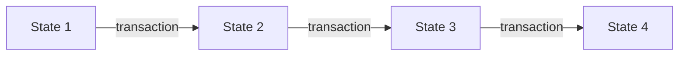

# What is Ethereum?

Ethereum is a **shared computer that nobody owns**.

That sentence is doing a lot of work, so let's take it apart properly. The most useful way to understand Ethereum is not as a currency, or a blockchain, or a network. It's as a **state machine** — and once that clicks, most other things about it stop being surprising.

## A state machine

A state machine is just two things:

1. Some **state** — the current situation. Facts about the world.
2. Some **rules** for changing that state.

A chess board is a state machine. The state is where the pieces are. The rules are the legal moves. Given a board and a move, everyone in the world can work out the new board and they'll all get the same answer. There's no ambiguity, and there's no need to trust the person telling you the move was made.

This isn't a metaphor invented to help beginners, incidentally. Ethereum's formal specification — the Yellow Paper — describes it in exactly these terms: a transaction-based state machine. The framing is the protocol's own.

Ethereum works exactly like this. Its state is every account and what each one holds:

| Address | Nonce | Balance | Code? |
| --- | --- | --- | --- |
| `0x5aAe...b48` | 12 | 2.5 ether | no |
| `0xA0b8...Eb48` | 1 | 0 ether | yes |
| `0xd8dA...6045` | 847 | 1,337 ether | no |

Its rule for changing that state is the **transaction**. One transaction in, one new state out.

That's Ethereum. Everything else on this site is detail about what's inside the state, what's inside a transaction, and how thousands of computers agree on which transactions happened and in what order.

!!! note "Two simplifications I'll correct later"

    **Accounts have four fields, not three.** Alongside the nonce and balance
    there are two 32-byte fingerprints — one for the account's stored data, one
    for its code. They need some groundwork to explain, so they wait for the
    [accounts](../accounts/accounts.md) page.

    **State is committed per block, not per transaction.** Transactions really
    are applied one at a time, and the diagram above is the right way to think
    about it. But Ethereum only finalises a new state once per *block* —
    the intermediate states between transactions exist during execution and are
    never canonical.

## What makes it different from Bitcoin

Bitcoin is also a state machine, with a narrower job.

It's often said that the difference is that Ethereum has code and Bitcoin doesn't. **That's not true.** Bitcoin has a scripting language, called Script, and it's used for real things: multi-signature wallets, timelocks, hash-locked payments.

The difference is what *kind* of code.

**Bitcoin's Script is deliberately stateless and limited.** It has no loops, and a script answers exactly one question: may this particular coin be spent? It cannot remember anything between transactions.

**Ethereum's contracts are stateful and Turing-complete.** They can loop, they keep their own storage, and they can read what they wrote last week. That's the real divide — not code versus no code, but *stateless and bounded* versus *stateful and general-purpose*.

Two things follow from this, and both matter.

### Accounts have persistent memory

In Bitcoin, coins are the state. In Ethereum, **accounts** are the state — each with a balance that goes up and down, like a bank account.

This sounds like a small implementation detail. It isn't, and it's why we cover [accounts](../accounts/accounts.md) early on this site. It means an address is a thing that *persists* and can *remember* something between transactions.

### Accounts can hold code

Some accounts have a program attached. These are **smart contracts**.

When you send a transaction to a contract account, you're not just moving money — you're *calling the program*, and it runs. It can check conditions, do arithmetic, store results, and send ether onward. Every node on the network runs the same code on the same state and gets the same answer.

Every step of that execution is **metered and capped**. The caller pays for each individual operation and sets a ceiling in advance, so a contract cannot run forever. That's what gas is for, and it's the reason an infinite loop in somebody's contract can't hang the network.

That's the actual novelty. Bitcoin lets you agree on *who owns what*. Ethereum lets you agree on *what a program computed*.

!!! note "So where does the "world computer" phrase come from?"

    This is the kernel of truth in it. Ethereum really does execute programs, and the whole network agrees on the results.

    But it's a terrible computer by any normal measure — it's slower than a phone from 2007, every operation costs real money, and all its data is public. It isn't useful because it's powerful. It's useful because **tampering with it is extraordinarily expensive, and no single party decides what it computed.**

    Worth being precise about that, though: it's *hard* to stop, not impossible. Validators can decline to include particular transactions, and the concentration of the firms that assemble blocks is a live, openly-debated concern. Censorship resistance is a matter of cost and probability, not a guarantee.

## Why would anyone want this?

Because the expensive part of a lot of agreements isn't the computing — it's the trusting.

If you and I bet on a football match, one of us has to hold the money, and the other has to trust them to pay out. Normally we solve this with an institution: a bank, an exchange, a court. Those work, but they cost money, take time, can refuse you, and only exist in some countries.

On Ethereum you can instead put the money somewhere neither of us controls, with the payout rule written as code. Neither of us has to be trusted to hold it, and neither does any third party.

### But there's a catch, and it's a big one

A contract can hold the money and release it without trusting anyone. **It cannot know who won the match.**

Contracts can only see what's on the chain. They have no internet connection, and they can't look anything up — if they could, two nodes might get different answers and the determinism that makes the whole system work would collapse.

So something outside has to report the result. That reporter is called an **oracle**, and the moment you need one, you're trusting it. You've moved the trust rather than removed it.

This is worth being honest about, because it's the gap most introductions skip. What smart contracts genuinely eliminate is the need to trust a **custodian** — whoever would otherwise hold the money. They do nothing about trusting whoever supplies facts about the outside world.

Which is why the applications that work best are the ones where **every relevant fact is already on-chain**: swapping one token for another, lending against on-chain collateral, an escrow both parties sign off on. No oracle needed, nothing to trust.

Whether the trade is worth it depends enormously on the situation. Plenty of things built on Ethereum would be better as an ordinary database. But when you genuinely can't agree on who should hold the money, it's a real answer.

## The two layers

One last thing before we move on, because it explains a lot of confusing terminology.

Modern Ethereum is split in two:

- The **execution layer** holds the accounts and runs the code. This is the state machine described above.
- The **consensus layer** decides the *order* of transactions, using Proof of Stake.

Here's how it ended up that way, because the history is counter-intuitive.

Until 2022, Ethereum mainnet did both jobs in one system, ordering transactions by mining. Meanwhile a second, separate chain called the **Beacon Chain** had been running since December 2020 — doing Proof of Stake consensus with no accounts and no transactions on it at all. It was a consensus layer with nothing to order, deliberately run in parallel so the mechanism could be proven before anything of value depended on it.

In September 2022, an upgrade called **The Merge** connected the two: the execution layer stopped running its own mining-based consensus and began taking its ordering from the beacon chain instead. Hence the name — two existing systems were joined together, which is why "merge" and not "split".

You'll see this division everywhere once you notice it — it's why Ethereum has two kinds of client software, and why blocks have two sets of fields. The consensus layer isn't covered on this site yet, for reasons explained in [how this site handles forks](../about/forks.md). For now, just know that **execution and ordering are separate jobs.**

---

## Recap

- Ethereum is a state machine: a shared state, plus transactions that change it.
- Its state is every **account** and its balance — not coins.
- Accounts can hold **code**, so the network can agree on the result of a computation. That code is stateful and general-purpose, unlike Bitcoin's, and every step of it is metered.
- Its value isn't speed. It's that tampering is prohibitively expensive and no single party decides the outcome.
- Contracts remove the need for a trusted **custodian**. They don't remove the need to trust whoever reports facts from outside the chain.

**Next:** [Ether, wei and gwei](ether.md) — the units, so the numbers on later pages mean something.
