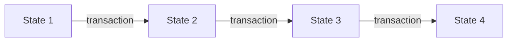

# What is Ethereum?

Ethereum is a **shared computer that nobody owns**.

That sentence is doing a lot of work, so let's take it apart properly. The most useful way to understand Ethereum is not as a currency, or a blockchain, or a network. It's as a **state machine** — and once that clicks, most other things about it stop being surprising.

## A state machine

A state machine is just two things:

1. Some **state** — the current situation. Facts about the world.
2. Some **rules** for changing that state.

A chess board is a state machine. The state is where the pieces are. The rules are the legal moves. Given a board and a move, everyone in the world can work out the new board and they'll all get the same answer. There's no ambiguity, and there's no need to trust the person telling you the move was made.

This isn't a metaphor invented to help beginners, incidentally. Ethereum's formal specification — the Yellow Paper [^yellowpaper] — describes it in exactly these terms: a transaction-based state machine. The framing is the protocol's own.

??? abstract "The formal version"

    The Yellow Paper writes the state transition as a function. If **σ** is the
    world state and **T** a transaction:

    ```
    σ(t+1)  ≡  Υ(σ(t), T)
    ```

    **Υ** (upsilon) is the state transition function: it takes a state and a
    transaction and returns the next state. Because Υ is a deterministic
    function, every node computing it on the same inputs necessarily arrives at
    the same output — which is the formal statement of the "no need to trust
    anyone" property described above.

    The same idea applies one level up, at the level of a **block** — a batch of
    transactions, bundled together and added to the chain as a single unit.
    (Blocks get a section of their own later; for now, a batch is all you need.)
    Writing **B** for a block, there is a block-level function **Π** that applies
    each of the block's transactions in order and then finalises the result:

    ```
    σ(t+1)  ≡  Π(σ(t), B)
    ```

    This is why state is committed per block rather than per transaction: Π is
    the function whose output gets recorded, and Υ is applied internally along
    the way.

Ethereum works exactly like this. Its state is every account and what each one holds:

| Address | Nonce | Balance | Code? |
| --- | --- | --- | --- |
| `0x5aAe...b48` | 12 | 2.5 ether | no |
| `0xA0b8...Eb48` | 1 | 0 ether | yes |
| `0xd8dA...6045` | 847 | 1,337 ether | no |

Its rule for changing that state is the **transaction**. One transaction in, one new state out.



That's Ethereum. Everything else on this site is detail about what's inside the state, what's inside a transaction, and how thousands of computers agree on which transactions happened and in what order.

!!! note "Two simplifications"

    **The address isn't one of the account's fields.** It's the key you look an
    account *up* by — like a name in an index — not something the account
    stores. So that table has four columns but shows only three stored values.

    An account stores exactly four things: the **nonce**, the **balance**, and
    two 32-byte fingerprints — one standing for everything the account holds in
    storage, one for its code. The `Code?` column above is a yes-or-no
    stand-in for that second fingerprint. Both fingerprints need groundwork to
    explain, so they wait for the [accounts](../accounts/accounts.md) page.

    **State is recorded per block, not per transaction.** Transactions really
    are applied one at a time, exactly as the diagram shows. But transactions
    travel in **[blocks](../glossary.md#block)** — batches of a hundred or two,
    added to the chain as a single unit — and Ethereum only *records* the state
    once per block, after every transaction in it has run.

    It's the difference between typing and saving. Every keystroke changes your
    document; only hitting **Save** writes anything to disk. The states in
    between genuinely existed, but nothing kept them.

    So the states between transactions are real, and no one has a record of
    them. Only the state at a block boundary is permanent and agreed on — which
    is why the **block** is the unit the network agrees about, and why you'll see
    everything from finality to reorganisations discussed per block rather than
    per transaction.

??? info "History: why not record state per transaction? They tried."

    It's a fair question, and Ethereum's first answer was the opposite of the
    current one.

    Before the **Byzantium** upgrade in 2017, every transaction carried its own
    post-transaction state root — exactly the per-transaction snapshot the
    design now lacks. You really could point at a single transaction and prove
    the state immediately after it.

    **EIP-658** [^eip658] removed that and replaced it with a one-bit
    success-or-failure status code. The reasoning was practical: computing and
    storing a full state fingerprint after every single transaction was
    expensive, and almost nothing used them.

    So the answer to "why not per transaction?" is that they did, and it wasn't
    worth the cost.

    One thing *is* still kept per transaction: its **receipt**, recording gas
    used, any logs emitted, and whether it succeeded. So per-transaction
    **outcomes** are committed; per-transaction **state snapshots** are not.
    That's the precise line.

## What makes it different from Bitcoin

Bitcoin is also a state machine, with a narrower job.

It's often said that the difference is that Ethereum has code and Bitcoin doesn't. **That's not true.** Bitcoin has a scripting language, called Script, and it's used for real things — wallets that need several people to approve a payment, or payments that can't be collected until a particular date.

The difference is what the code is allowed to *do*.

**A Bitcoin script answers one yes-or-no question:** may this particular piece of money be spent, by this person, right now? It runs, it gives its answer, and it forgets everything. It has nowhere to store anything, and no way to look at what happened last week.

**An Ethereum program has a memory of its own.** It gets its own space to write things down, and what it writes survives — so it can keep a count, record who did what, and read back a year later something it wrote today. It also isn't confined to a single yes-or-no answer; it can work through any calculation you can describe.

That's the real divide. Not code versus no code, but **a one-off check versus a program that remembers.**

??? abstract "The formal version"

    In the usual terminology: Bitcoin's Script is **stateless** and
    deliberately **not Turing-complete** — it has no loops or recursion, so
    every script provably terminates, and its only output is whether a spend is
    authorised. Bounded execution comes free from the restricted language.

    Ethereum's contracts are **stateful** — each has a persistent key–value
    store, addressed by 32-byte keys, that survives between calls — and the
    EVM *is* Turing-complete. Termination therefore cannot come from the
    language, so it's imposed economically instead: every operation costs gas,
    the caller fixes a limit in advance, and execution halts when the limit is
    reached.

    The design trade is explicit. Bitcoin buys guaranteed termination by giving
    up expressiveness. Ethereum keeps expressiveness and buys termination with
    metering.

Two things follow from this, and both matter.

### Accounts have persistent memory

**In Bitcoin, the state is a collection of separate chunks of money.** Each chunk was produced by some earlier payment, and each can be spent exactly once, in full. There is no stored balance anywhere: your wallet works out "you have 0.4 bitcoin" by adding up the chunks it's able to spend. Spending one destroys it and creates new chunks — one for the recipient, one returning your change.

**In Ethereum, accounts are the state.** Your balance is a single number recorded against your address, and it goes up and down. Much closer to a bank account.

This sounds like a small implementation difference. It isn't, and it's why we cover [accounts](../accounts/accounts.md) early on this site. It means an address is a thing that *persists* — somewhere to attach a balance, a counter, and eventually storage and code. Bitcoin has no equivalent place to put any of that, because it has no lasting object to attach it to.

!!! info "The name for Bitcoin's chunks"

    Those chunks of money are called **UTXOs** — unspent transaction outputs.
    You'll meet the term constantly in comparisons between the two systems,
    and it's worth knowing even though nothing on Ethereum uses it.

### Accounts can hold code

Some accounts have a program attached. These are **[smart contracts](../glossary.md#smart-contract)**.

When you send a transaction to a contract account, you're not just moving money — you're *calling the program*, and it runs. It can check conditions, do arithmetic, store results, and send ether onward. Every node on the network runs the same code on the same state and gets the same answer.

Every step of that execution is **metered and capped**. The caller pays for each individual operation, and sets a ceiling in advance on how much work they're willing to pay for. (The unit that work is counted in is called **[gas](../glossary.md#gas)**; it gets a page of its own later.) When the ceiling is reached, execution stops — which is why an infinite loop in somebody's contract can't hang the network.

That's the actual novelty. Bitcoin lets you agree on *who owns what*. Ethereum lets you agree on *what a program computed*.

!!! note "So where does the "world computer" phrase come from?"

    This is the kernel of truth in it. Ethereum really does execute programs, and the whole network agrees on the results.

    But it's a terrible computer by any normal measure — it's slower than a phone from 2007, every operation costs real money, and all its data is public. It isn't useful because it's powerful. It's useful because **tampering with it is extraordinarily expensive, and no single party decides what it computed.**

    Worth being precise about that, though: it's *hard* to stop, not impossible. Validators can decline to include particular transactions, and the concentration of the firms that assemble blocks is a live, openly-debated concern. Censorship resistance is a matter of cost and probability, not a guarantee.

## Why would anyone want this?

Because the expensive part of a lot of agreements isn't the computing — it's the trusting.

Suppose you're buying a second-hand camera from a stranger in another country. You'd rather not send the money before the camera arrives. They'd rather not post it before they've been paid. Someone has to go first, and whoever goes first carries all the risk.

Normally an institution solves this: a marketplace that holds the payment until delivery, a bank, a card issuer who will reverse the charge. These work — but they cost money, take time, can refuse you, and only exist in some countries.

On Ethereum you can instead put the money somewhere **neither of you controls**, with the release rule written as code. Neither of you has to be trusted to hold it, and neither does any third party.

### But there's a catch, and it's a big one

A contract can hold the money and release it without trusting anyone. **It cannot know whether the camera arrived.**

Contracts can only see what's on the chain. They have no internet connection, and they can't look anything up — if they could, two nodes might get different answers and the determinism that makes the whole system work would collapse.

So something outside has to report the result. That reporter is called an **[oracle](../glossary.md#oracle)**, and the moment you need one, you're trusting it. You've moved the trust rather than removed it.

This is worth being honest about, because it's the gap most introductions skip. What smart contracts genuinely eliminate is the need to trust a **custodian** — whoever would otherwise hold the money. They do nothing about trusting whoever supplies facts about the outside world.

Which is why the applications that work best are the ones where **every relevant fact is already on-chain**: swapping one token for another, lending against on-chain collateral, an escrow both parties sign off on. No oracle needed, nothing to trust.

Whether the trade is worth it depends enormously on the situation. Plenty of things built on Ethereum would be better as an ordinary database. But when you genuinely can't agree on who should hold the money, it's a real answer.

## The two layers

One last thing before we move on, because it explains a lot of confusing terminology.

Modern Ethereum is split in two:

- The **execution layer** holds the accounts and runs the code. This is the state machine described above.
- The **consensus layer** decides the *order* of transactions, using [Proof of Stake](../glossary.md#proof-of-stake).

Here's how it ended up that way, because the history is counter-intuitive.

Until 2022, Ethereum mainnet did both jobs in one system, ordering transactions by mining. Meanwhile a second, separate chain called the **Beacon Chain** had been running since December 2020 — doing Proof of Stake consensus with no accounts and no transactions on it at all. It was a consensus layer with nothing to order, deliberately run in parallel so the mechanism could be proven before anything of value depended on it.

In September 2022, an upgrade called **The Merge** connected the two: the execution layer stopped running its own mining-based consensus and began taking its ordering from the beacon chain instead. Hence the name — two existing systems were joined together, which is why "merge" and not "split".

You'll see this division everywhere once you notice it — it's why Ethereum has two kinds of client software, and why blocks have two sets of fields. The consensus layer isn't covered on this site yet, for reasons explained in [how this site handles forks](../about/forks.md). For now, just know that **execution and ordering are separate jobs.**

---

## Recap

- Ethereum is a state machine: a shared state, plus transactions that change it.
- Its state is every **account** and its balance — not coins.
- Accounts can hold **code**, so the network can agree on the result of a computation. That code is stateful and general-purpose, unlike Bitcoin's, and every step of it is metered.
- Its value isn't speed. It's that tampering is prohibitively expensive and no single party decides the outcome.
- Contracts remove the need for a trusted **custodian**. They don't remove the need to trust whoever reports facts from outside the chain.

**Next:** [Ether, wei and gwei](ether.md) — the units, so the numbers on later pages mean something.

---

## Sources

<div class="sources" markdown>

[^yellowpaper]:
    Wood, G. *Ethereum: A Secure Decentralised Generalised Transaction Ledger.*
    Ethereum project yellow paper. The formal specification; §2 and §4 cover the
    state transition function and account state.
    <https://ethereum.github.io/yellowpaper/paper.pdf>

- Buterin, V. (2014). *Ethereum White Paper: A Next-Generation Smart Contract and Decentralized Application Platform.* The original design rationale, including the account-versus-UTXO argument. <https://ethereum.org/en/whitepaper/>
- Nakamoto, S. (2008). *Bitcoin: A Peer-to-Peer Electronic Cash System.* For the Bitcoin comparison and the UTXO model. <https://bitcoin.org/bitcoin.pdf>
- Zhang, F., Cecchetti, E., Croman, K., Juels, A., & Shi, E. (2016). *Town Crier: An Authenticated Data Feed for Smart Contracts.* ACM CCS 2016. States the oracle problem formally and surveys why contracts cannot query external data.
- Buterin, V., & Griffith, V. (2017). *Casper the Friendly Finality Gadget.* arXiv:1710.09437. The consensus layer's finality mechanism.
- Daian, P., Goldfeder, S., Kell, T., Li, Y., Zhao, X., Bentov, I., Breidenbach, L., & Juels, A. (2019). *Flash Boys 2.0: Frontrunning, Transaction Reordering, and Consensus Instability in Decentralized Exchanges.* IEEE S&P 2020. Evidence base for the transaction-ordering and censorship concerns noted above.

### On The Merge and the two layers

- EIP-3675: *Upgrade consensus to Proof-of-Stake.* The specification of The Merge itself — how the execution layer stopped running its own consensus. <https://eips.ethereum.org/EIPS/eip-3675>
- EIP-4399: *Supplant DIFFICULTY opcode with PREVRANDAO.* A concrete illustration of what the switch changed at the execution layer. <https://eips.ethereum.org/EIPS/eip-4399>
- Edgington, B. *Upgrading Ethereum: A technical handbook on Ethereum's move to proof of stake and beyond.* The most thorough documentation of the consensus layer available, and free to read. <https://eth2book.info>
- Ethereum Foundation. *Consensus specifications.* The executable specification of the Beacon Chain, including the Bellatrix release that handled the transition. <https://github.com/ethereum/consensus-specs>
- Ethereum.org. *The Merge.* Maintained overview, with dates and the reasoning behind the design. <https://ethereum.org/en/roadmap/merge/>

[^eip658]:
    EIP-658: *Embedding transaction status code in receipts.* Byzantium, 2017.
    Replaced the intermediate post-transaction state root in each receipt with a
    success/failure status code.
    <https://eips.ethereum.org/EIPS/eip-658>

</div>

!!! warning "Verify before publishing"

    I have not personally checked every citation above against the original
    text. Confirm each one — author list, year, venue, and that it says what
    this page claims it says — before this page goes public. A wrong citation
    is worse than none.
