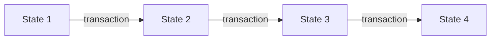

# What is Ethereum?

Ethereum is a **shared computer that nobody owns**.

That sentence is doing a lot of work, so let's take it apart properly. The most useful way to understand Ethereum is not as a currency, or a blockchain, or a network. It's as a **state machine** — and once that clicks, most other things about it stop being surprising.

## A state machine

A state machine is just two things:

1. Some **state** — the current situation. Facts about the world.
2. Some **rules** for changing that state.

A chess board is a state machine. The state is where the pieces are. The rules are the legal moves. Given a board and a move, everyone in the world can work out the new board and they'll all get the same answer. There's no ambiguity, and there's no need to trust the person telling you the move was made.

Ethereum works exactly like this. Its state is a giant list of **accounts** and what each one holds:

| Address | Balance | Code? |
| --- | --- | --- |
| `0x5aAe...b48` | 2.5 ether | no |
| `0xA0b8...Eb48` | 0 ether | yes |
| `0xd8dA...6045` | 1,337 ether | no |

Its rule for changing that state is the **transaction**. One transaction in, one new state out.

That's Ethereum. Everything else on this site is detail about what's inside the state, what's inside a transaction, and how thousands of computers agree on which transactions happened and in what order.

## What makes it different from Bitcoin

Bitcoin is also a state machine, but it has a much smaller job: it tracks **who owns how much bitcoin**, and the only legal move is to send some.

Ethereum keeps two extra things in its state, and both are a big deal.

### Accounts have persistent memory

In Bitcoin, coins are the state. In Ethereum, **accounts** are the state — each with a balance that goes up and down, like a bank account.

This sounds like a small implementation detail. It isn't, and it's why we cover [accounts](../accounts/accounts.md) early on this site. It means an address is a thing that *persists* and can *remember* something between transactions.

### Accounts can hold code

Some accounts have a program attached. These are **smart contracts**.

When you send a transaction to a contract account, you're not just moving money — you're *calling the program*, and it runs. It can check conditions, do arithmetic, store results, and send ether onward. Every node on the network runs the same code on the same state and gets the same answer.

That's the actual novelty. Bitcoin lets you agree on *who owns what*. Ethereum lets you agree on *what a program computed*.

!!! note "So where does the "world computer" phrase come from?"

    This is the kernel of truth in it. Ethereum really does execute programs, and the whole network agrees on the results.

    But it's a terrible computer by any normal measure — it's slower than a phone from 2007, every operation costs real money, and all its data is public. It's not useful because it's powerful. It's useful because **nobody can stop it or lie about what it computed.** Judge it as a machine that can't be tampered with, not as a machine that's fast.

## Why would anyone want this?

Because the expensive part of a lot of agreements isn't the computing — it's the trusting.

If you and I bet on a football match, one of us has to hold the money, and the other has to trust them to pay out. Normally we solve this with an institution: a bank, an exchange, a court. Those work, but they cost money, take time, can refuse you, and only exist in some countries.

On Ethereum you can instead write the payout rule as code and put it somewhere neither of us controls. Not because code is cleverer than a court, but because **neither of us has to be trusted**, and neither does any third party.

Whether that trade is worth it depends enormously on the situation. Plenty of things built on Ethereum would be better as an ordinary database. But when you genuinely can't agree on who should hold the money, it's a real answer.

## The two layers

One last thing before we move on, because it explains a lot of confusing terminology.

Modern Ethereum is split in two:

- The **execution layer** holds the accounts and runs the code. This is the state machine described above.
- The **consensus layer** decides the *order* of transactions, using Proof of Stake.

These used to be one system. In September 2022, in an upgrade called **The Merge**, Ethereum replaced its mining-based ordering with Proof of Stake and the two layers split apart.

You'll see this split everywhere once you notice it — it's why Ethereum has two kinds of client software, and why blocks have two sets of fields. The consensus layer isn't covered on this site yet, for reasons explained in [how this site handles forks](../about/forks.md). For now, just know that **execution and ordering are separate jobs.**

---

## Recap

- Ethereum is a state machine: a shared state, plus transactions that change it.
- Its state is a list of **accounts** with balances — not coins.
- Accounts can hold **code**, so the network can agree on the result of a computation.
- Its value isn't speed, it's that no one can tamper with it or lie about the outcome.

**Next:** [Ether, wei and gwei](ether.md) — the units, so the numbers on later pages mean something.
